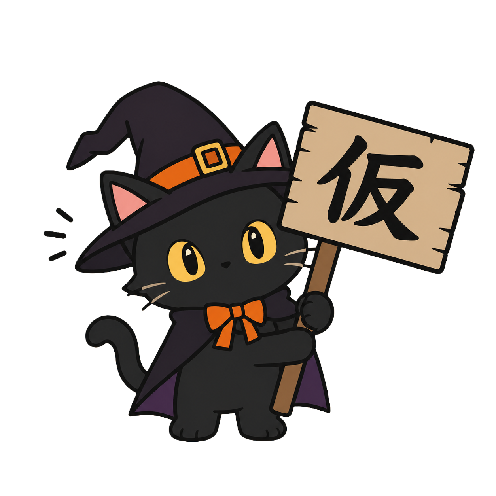

# お化け屋敷サイトをつくろう 🎃

オープンキャンパス Webデザイン学科 ハロウィーン体験講座（30分）

このフォルダの HTML ファイルを書きかえて、
自分だけのお化け屋敷サイトを完成させます。

## つかうファイル

| ファイル             | なに？                                                             |
| -------------------- | ------------------------------------------------------------------ |
| `index-start.html`   | **講座で書きかえるファイル（これを使います）**                      |
| `index.html`         | 完成見本：**ホラー** 黒 × オレンジ／明朝体                          |
| `index-cartoon.html` | 完成見本：**カートゥーン** むらさきの夜空／まるい文字               |
| `shikumi.css`        | 見た目のしくみ（`index-start.html` が読みこむ。さわらなくてOK）     |
| `shikumi.js`         | スクロールでふわっと出すしくみ（さわらなくてOK）                    |

まず見本の2つをダブルクリックして、どんなサイトができるのか見てみましょう。
そのあと `index-start.html` を開いて、**★①〜⑤を選んでいきます**。

### 自分で決めるのは、5つだけ

`index-start.html` は、**文章はぜんぶ書いてあります**。
さいしょは **はい色の背景・黒い文字・動きなし** の、わざと地味な状態です。
みなさんが決めるのは、この5つです。

| ★   | 決めるもの             | どこにある？                         |
| --- | ---------------------- | ------------------------------------ |
| ①   | 背景色                 | `<style>` のいちばん上（`body`）      |
| ②   | 文字色                 | 〃                                   |
| ③   | 見出し（色・フォント） | 〃（`h1, h2`）                        |
| ④   | アニメーション         | 〃（大きい文字と、背景の画像3つ）     |
| ⑤   | 画像                   | `<body>` の中（4か所）                |

色は **`#` のあとの6けたを、自分で決めます**。
フォントとアニメーションは、コメントに書いてある候補から選びます。

同じ文章でも、**色・フォント・動き・画像を変えるだけで
まったくちがうサイトになる**——それがこの講座のテーマです。

---

## つかうもの

- パソコン（Windows / Mac どちらでもOK）
- メモ帳・テキストエディット・VSCode など、文字が打てるソフト
- ブラウザ（Chrome など）

インターネットにつながっていれば、それ以外の準備はいりません。

---

## はじめかた

1. `index-start.html` を **ダブルクリック** する
   → ブラウザが開いて、いまの状態のサイトが表示されます

2. 同じファイルを右クリック →「プログラムから開く」→ **エディタ** を選ぶ
   → 中身のコード（設計図）が見られます

3. コードを書きかえて **保存**（Ctrl+S / ⌘+S）

4. ブラウザに戻って **更新**（F5 / ⌘+R）
   → 書きかえた内容が反映されます！

> **コツ**
> 「保存 → 更新」をこまめにくり返すのが、いちばん早く上達する方法です。
> 少し変えたらすぐ見る、を習慣にしてください。

---

## 色を決める（★①〜③）

`<style>` のいちばん上に、こう書いてあります。

```css
body {
    background-color: #cccccc; /* ★① 背景色 */
    color: #222222;            /* ★② 文字色 */
}
```

`#cccccc` の部分を、**自分で考えた色** に書きかえます。

**色の書きかた**

`#` のあとの6けたは、2けたずつ **赤・緑・青** の強さです。
`00`（なし）〜 `ff`（いっぱい）で、使える文字は `0〜9` と `a〜f` だけ。

| 書く色    | できる色   |
| --------- | ---------- |
| `#000000` | くろ       |
| `#ffffff` | しろ       |
| `#ff0000` | あか       |
| `#ff8800` | オレンジ   |
| `#330033` | こい むらさき |

数字を少しずつ変えて、自分だけの色を見つけましょう。
VSCode なら、色の四角をクリックすると色えらびの画面が出ます。

同じやりかたで、**★③ 見出し**（`h1, h2` の `color`）の色も決めます。
見出しのフォント（`font-family`）は、コメントの候補から選んで書きかえます。

> **コツ**
> 背景色と文字色がにていると、読めなくなります。
> 「暗い背景 × 明るい文字」か「明るい背景 × 暗い文字」にしましょう。

---

## 動きをつける（★④）

アニメーションは、**さいしょは ぜんぶ `none`（動かない）** です。

```css
h1       { animation: none; } /* 大きい文字 */
.haikei1 { animation: none; } /* 背景の画像1 */
.haikei2 { animation: none; } /* 背景の画像2 */
.haikei3 { animation: none; } /* 背景の画像3 */
```

この `none` を、下の表の言葉に書きかえると、動きだします。
大きい文字と、**背景にうかぶ画像3つ**（`.haikei1`〜`.haikei3`）を、それぞれ動かせます。

| 書く言葉                           | 動き                     |
| ---------------------------------- | ------------------------ |
| `flicker 4s infinite`              | ろうそくみたいにチカチカ |
| `wobble 3s ease-in-out infinite`   | ゆらゆら かたむく        |
| `shake 0.4s infinite`              | ぶるぶる ふるえる        |
| `float 3s ease-in-out infinite`    | ふわふわ 浮く            |
| `bounce 0.9s ease-in-out infinite` | ぴょんぴょん はずむ      |
| `spin 8s linear infinite`          | ぐるぐる まわる          |
| `none`                             | 動かさない（さいしょはこれ） |

`4s` や `0.4s` は「1回の動きにかかる秒数」です。数字を変えると速さが変わります。

※ スクロールすると文字がふわっと出てくる動きは、
　 JavaScript がやっているので、さいしょから入っています。

> **コツ**
> 3つの画像を、ぜんぶちがう動きにしてみましょう。
> **背景はこわいのに、動きだけかわいい** ようにすると、
> かえって不気味になります。ちぐはぐを、わざと作ってみましょう。

---

## 画像を入れかえる（★⑤）

さいしょは、4か所ぜんぶに **仮の画像**（`img/kari.png` の黒ねこ）が
入っています。これを本番の画像に取りかえるのが、★⑤です。

- **画像1**：いちばん上の大きい画像
- **画像2〜4**：セクションの背景にうかぶ画像（「逃げられるか？」「3つの恐怖」「開催情報」に1つずつ。
  そのセクションを見ているあいだ、画面についてきます。★④で動かせます）

```html

                        ↓ 書きかえる

```

`img` フォルダには、こわさちがいの画像が2セット入っています。

| フォルダ       | 雰囲気                              | 入っているもの                   |
| -------------- | ----------------------------------- | -------------------------------- |
| `img/gekikowa` | **げきこわ** 写真みたいで本気こわい | かぼちゃ・おばけ・こうもり・黒猫 |
| `img/tyoikowa` | **ちょいこわ** イラストでかわいい   | かぼちゃ・おばけ・こうもり・黒猫 |

**ファイル名の一覧**（ここからコピペしてください）

| なに     | `img/gekikowa/…`（げきこわ）  | `img/tyoikowa/…`（ちょいこわ）     |
| -------- | ----------------------------- | ---------------------------------- |
| かぼちゃ | `Rotting_jack-o'-lantern.png` | `Jack-o'-lantern_pumpkin.png`      |
| おばけ   | `Pale_ghost_with_hollow.png`  | `White_ghost_floating_playful.png` |
| こうもり | `Swarm_of_bats_flying.png`    | `Bat_hanging.png`                  |
| 黒ねこ   | `Menacing_black_cat.png`      | `Black_cat_wearing.png`            |

**入れかえる場所は4か所**

1. いちばん上の大きい画像（かぼちゃがおすすめ）
2. 背景の画像1／「逃げられるか？」（おばけ）
3. 背景の画像2／「3つの恐怖」（こうもり）
4. 背景の画像3／「開催情報」（黒猫）

> **コツ**
> ファイル名は1文字でもまちがえると、画像がこわれたマークになります。
> ファイル名は、そのままコピペするのが確実です。
>
> げきこわ と ちょいこわ を **まぜてもOK**。
> 1枚だけ ちょいこわ にすると、そこだけ気がぬけて面白くなります。
>
> `alt="..."` は「画像が出なかったときに出る文字」です。
> 目の見えない人にも伝わるように、画像1には何の絵かを書いておきます。
> 背景の画像は かざりなので、`alt=""`（から）のままでOKです。

絵文字を使いたいところ（警告の ⚠️ など）は、そのままでOKです。

```
🎃 👻 🕷 🕸 🦇 💀 🧟 🩸 🕯 🪦 ⚰️ 🌕 🔪 🚪 🖤
```

Windows は `Windows キー + .`、Mac は `⌘ + Control + Space` で出せます。

---

## かくれんぼが最大の見せ場（よゆうがある人へ）

```html
<div class="line reveal">もういいかい</div>
<div class="line reveal">まあだだよ</div>
```

この2行は、もう入っています。**コピペで増やす**ほど、こわさが増していきます。
そして最後の1行だけ——

```html
<div class="line last reveal">もういいよ</div>
```

言葉が変わります。

**同じことをくり返して、最後だけ裏切る。**
これだけで恐怖が生まれます。プロのホラーサイトも使っている手法です。

---

## こまったとき

**Q. 画面がまっ白になった**
→ `<` `>` `"` を消してしまった可能性大。Ctrl+Z（⌘+Z）で戻しましょう。

**Q. 文字化けした**
→ 保存するときの文字コードを **UTF-8** にしてください。

**Q. 変えたのに反映されない**
→ 保存を忘れているか、更新を忘れています。両方やってみてください。

**Q. こわしてしまった**
→ 元のファイルをもう一度コピーすれば、やり直せます。遠慮なくスタッフへ。

---

## もっとやってみたい人へ

- カードを4つ、5つに増やす（`<div class="card reveal">` ごとコピペ）
- 表に行を足す（`<tr><th>◯◯</th><td>◯◯</td></tr>` をコピペ）
- `shikumi.css` を開いて、数字をいじってみる
  - ビネット（四すみの暗さ）：`body::after` の `rgba(0, 0, 0, 0)` の最後の `0` → `0.85`
  - 背景の画像：`.haikei` の うすさ（`opacity`）や、くっつく位置（`top`）
- 文章も、自分のことばに書きかえてみる

数字をいじって、こわれても大丈夫です。
**こわして直すのが、いちばん早い上達法です。**

---

## 持ち帰りかた

完成したファイルは、USBメモリにコピーするか、
スタッフの案内するQRコードから受けとってください。
おうちのパソコンでも、同じように開けます。
