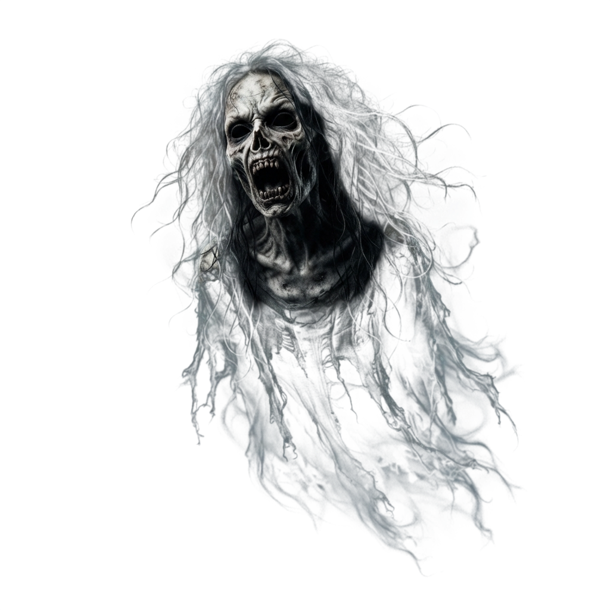

# お化け屋敷サイトをつくろう 🎃

オープンキャンパス Webデザイン学科 ハロウィーン体験講座（30分）

このフォルダの HTML ファイルを書きかえて、
自分だけのお化け屋敷サイトを完成させます。

## どっちで作る？

**見た目のちがう2つのファイル**が入っています。好きなほうを選んでください。
中身のしくみ（★の番号・書きかえる場所）は、どちらもまったく同じです。

| ファイル             | 雰囲気                                                       |
| -------------------- | ------------------------------------------------------------ |
| `index.html`         | **ホラー** 黒 × オレンジ／明朝体／写真みたいな画像           |
| `index-cartoon.html` | **カートゥーン** むらさきの夜空／まるい文字／イラストの画像   |

まよったら、まず両方ダブルクリックして見くらべてみましょう。

---

## つかうもの

- パソコン（Windows / Mac どちらでもOK）
- メモ帳・テキストエディット・VSCode など、文字が打てるソフト
- ブラウザ（Chrome など）

インターネットにつながっていれば、それ以外の準備はいりません。

---

## はじめかた

1. 選んだファイルを **ダブルクリック** する
   → ブラウザが開いて、見本のサイトが表示されます

2. 同じファイルを右クリック →「プログラムから開く」→ **エディタ** を選ぶ
   → 中身のコード（設計図）が見られます

3. コードを書きかえて **保存**（Ctrl+S / ⌘+S）

4. ブラウザに戻って **更新**（F5 / ⌘+R）
   → 書きかえた内容が反映されます！

> **コツ**
> 「保存 → 更新」をこまめにくり返すのが、いちばん早く上達する方法です。
> 少し変えたらすぐ見る、を習慣にしてください。

---

## 書きかえる場所

コードの中の **★** を探してください。10か所あります。
★のついたところ **だけ** 書きかえればOKです。

| ★   | 場所           | 変えられるもの                              |
| --- | -------------- | ------------------------------------------- |
| ①   | タイトル       | ブラウザのタブに出る名前                    |
| ②   | カラーパレット | サイト全体の色（3種類から選ぶ）             |
| ③   | ローディング   | 最初に出てくる画面                          |
| ④   | ヒーロー       | 大きなタイトルとキャッチコピー              |
| ⑤   | 警告           | 「不可解なことが起こります」の文            |
| ⑥   | 紹介文         | お化け屋敷のストーリー                      |
| ⑦   | 見どころ3つ    | カードの画像・見出し・説明                  |
| ⑧   | 開催情報       | 日にち・場所・料金などの表                  |
| ⑨   | かくれんぼ     | 「もういいかい / まあだだよ」← **見せ場！** |
| ⑩   | フッター       | いちばん下の文                              |

**全部やらなくても完成します。** まずは ④ → ⑥ → ⑦ の順がおすすめです。

---

## 色を変える（★②）

`index-cartoon.html` には、パレットが3種類入っています。

- **A** よぞら　むらさき × オレンジ
- **B** おひさま　オレンジ × クリーム
- **C** ミント × ぶどう

使いたいものを残して、**いらないものは前後を `/*` と `*/` ではさむ**と消えます。
最初はAが有効になっています。

（`index.html` に入っているのは、いまのところ A だけです）

もっと暗くしたいときは `--bg` の色を `#000000` にしてください。

---

## 画像をつかう（★⑦など）

`img` フォルダに、こわさちがいの画像が2セット入っています。

| フォルダ        | 雰囲気                             |
| --------------- | ---------------------------------- |
| `img/gekikowa`  | **げきこわ** 写真みたいで本気こわい |
| `img/tyoikowa`  | **ちょいこわ** イラストでかわいい   |

どちらにも「かぼちゃ・おばけ・こうもり・黒猫」の4種類があります。
最初は **げきこわ** が使われています。

画像は、こう書いてあります。

```html

```

`src="..."` の中の **フォルダ名とファイル名** を書きかえると、絵が変わります。

```html
<!-- げきこわ → ちょいこわ に変える例 -->

```

> **コツ**
> ファイル名は1文字でもまちがえると、画像がこわれたマークになります。
> フォルダの中のファイル名を、そのままコピペするのが確実です。
>
> `alt="..."` は「画像が出なかったときに出る文字」です。
> 目の見えない人にも伝わるように、何の絵かを書いておきます。

まだ絵文字を使いたいところ（★⑤の ⚠️ など）は、そのままでOKです。

```
🎃 👻 🕷 🕸 🦇 💀 🧟 🩸 🕯 🪦 ⚰️ 🌕 🔪 🚪 🖤
```

Windows は `Windows キー + .`、Mac は `⌘ + Control + Space` で出せます。

---

## かくれんぼ（★⑨）が最大の見せ場

```html
<div class="line reveal">もういいかい</div>
<div class="line reveal">まあだだよ</div>
```

この2行を **コピペで増やす** ほど、こわさが増していきます。
そして最後の1行だけ——

```html
<div class="line last reveal">もういいよ</div>
```

言葉が変わります。

**同じことをくり返して、最後だけ裏切る。**
これだけで恐怖が生まれます。プロのホラーサイトも使っている手法です。

---

## こまったとき

**Q. 画面がまっ白になった**
→ `<` `>` `"` を消してしまった可能性大。Ctrl+Z（⌘+Z）で戻しましょう。

**Q. 文字化けした**
→ 保存するときの文字コードを **UTF-8** にしてください。

**Q. 変えたのに反映されない**
→ 保存を忘れているか、更新を忘れています。両方やってみてください。

**Q. こわしてしまった**
→ 元のファイルをもう一度コピーすれば、やり直せます。遠慮なくスタッフへ。

---

## もっとやってみたい人へ

- カードを4つ、5つに増やす（`<div class="card reveal">` ごとコピペ）
- 表に行を足す（`<tr><th>◯◯</th><td>◯◯</td></tr>` をコピペ）
- ビネット（四すみの暗さ）を `0.85` → `0.95` に変えてみる
- ローディングの `3.2s` を長くして、じらしてみる

数字をいじって、こわれても大丈夫です。
**こわして直すのが、いちばん早い上達法です。**

---

## 持ち帰りかた

完成したファイルは、USBメモリにコピーするか、
スタッフの案内するQRコードから受けとってください。
おうちのパソコンでも、同じように開けます。
